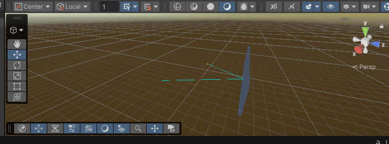

Quero tentar aprender melhor como projetar os raios que o usuario vai fazer quando ele quiser "ver" o ambiente. Agora é só o passo da projeção, a aparencia e visibilidade podem ficar para outra etapa.

https://www.youtube.com/watch?v=GkStW8-Q5P0

O disparo parte da posição do emissor e segue sua direção frontal. Um Raycast encontra o ponto de impacto e a normal da parede, um vetor perpendicular à superfície. Vector3.Reflect(direction, hit.normal) usa a direção de chegada e essa normal para calcular a direção refletida. A velocidade controla quanto o rastro avança por segundo; ela é independente do cálculo da reflexão.

if (!Physics.Raycast(origin, direction, out RaycastHit hit,
                distanceBudget, wallLayers, QueryTriggerInteraction.Ignore))
        {
            line.positionCount = 2;
            line.SetPosition(0, origin);
            line.SetPosition(1, origin + direction * distanceBudget);
            return;
        }

O Physics.Raycast verifica se há algum collider a partir de origin, na direção direction, até a distância distanceBudget, considerando as camadas de wallLayers e ignorando triggers; se houver impacto, seus dados são armazenados em hit. O operador ! faz o bloco executar quando nada é atingido: line.positionCount = 2 define dois pontos para a linha, o primeiro é colocado na origem e o segundo em origin + direction * distanceBudget, formando uma linha reta até o alcance máximo. Por fim, return encerra a execução do método.

